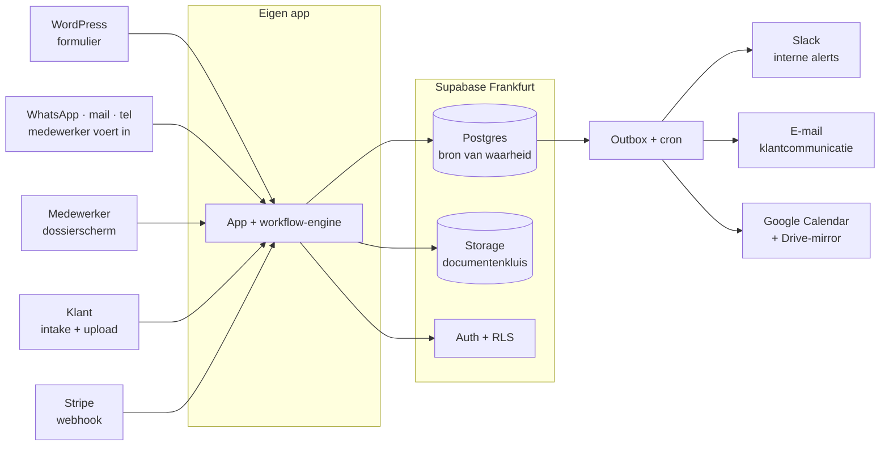
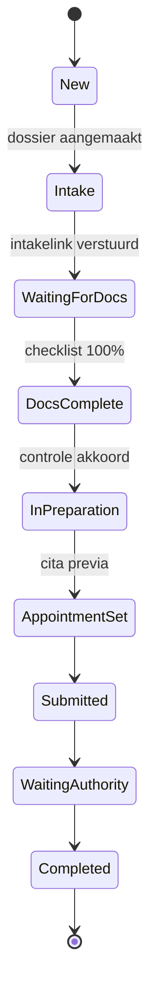
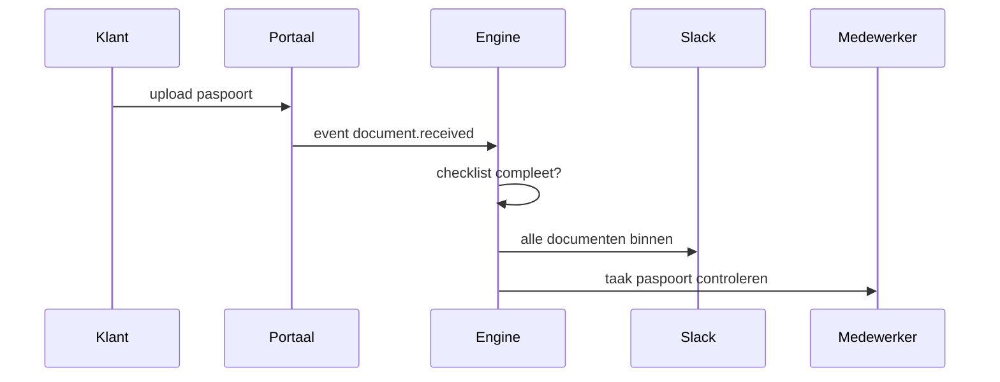

# Solmara Portaal — Plan van Aanpak

Bijgewerkt 18 september 2026

## Samenvatting en aanbeveling

Bouw één webapp die Airtable, Make en Fillout vervangt, en houd Slack, Gmail, Drive en Stripe als koppeling. Het team werkt dan in één scherm: *dit zijn mijn zaken, dit moet ik vandaag doen*. Er zijn geen Make-scenario's meer om te onderhouden en geen twee plekken waar dezelfde status staat.

De kern van het ontwerp is dat de workflow **data is, geen code**. Elke dienst — NIE Application, Mortgage Assistance, Property Purchase — is een versioneerd template met stages, documentchecklist, standaardtaken, SLA's en meldingen. Een vierde dienst toevoegen is dan een formulier invullen in de beheeromgeving, geen ontwikkelopdracht. Dat is het verschil tussen een tool die twee jaar meegaat en een tool die na de eerste nieuwe dienst weer bij de ontwikkelaar terugkomt.

Aanbevolen opzet: één Next.js-app met Supabase in Frankfurt voor database, auth en documentopslag, en automatiseringen via een outbox met cron. We starten op de gratis tiers, met de app in de bouwfase op een eigen homelab. Cloudflare blijft aan de rand voor DNS, WAF en Turnstile, maar levert niet de database — daarover meer in *Techstack*.

Wat nu **niet** gebouwd wordt: het klantportaal (fase 4, pas als het interne proces staat), facturatie (blijft in het boekhoudpakket vanwege Verifactu) en de WhatsApp Business API (eerst handmatig loggen).

## Scope en rolverdeling

De knip met de agency ligt bij het contactformulier: alles wat publiek en marketing is blijft WordPress, alles wat dossier is wordt het portaal. Er is precies één raakvlak, en dat is een webhook.

| Onderdeel | Wie | Opmerking |
| --- | --- | --- |
| solmara.es, content, SEO, blog | Agency (WordPress) | Onaangeroerd |
| Contact- en aanvraagformulier | Agency | Post naar `POST /api/leads` met API-key, plus Turnstile tegen spam |
| Prijzen- en dienstenpagina's | Agency | Diensten hoeven niet uit het portaal te komen |
| Medewerkersportaal | Wij | Aparte app op `app.solmara.es` |
| Intake- en uploadlink voor klanten | Wij | Vervangt Fillout, op `app.solmara.es/intake/<token>` |
| Workflow, taken, meldingen | Wij | Vervangt Make |
| Dossier- en documentopslag | Wij | Vervangt Airtable als bron van waarheid |
| Klantportaal met login | Wij, fase 4 | Zelfde codebase, andere rol |
| Facturen en boekhouding | Gestor of boekhoudpakket | Niet bouwen, zie *Integraties* |

Drie dingen die expliciet buiten scope blijven, zodat er later geen discussie over is: we bouwen geen CMS voor de website, geen eigen e-mailclient (Gmail blijft waar het team mailt) en geen boekhouding. En we bouwen geen tweede plek waar een status staat — als het portaal de bron van waarheid is, dan is Airtable weg, niet "ook nog even bijgehouden".

Afspraak met de agency die nu al gemaakt kan worden: vraag om het formulier te laten posten naar een endpoint dat wij aanleveren, met velden voor naam, e-mail, telefoon, taal, gewenste dienst en vrij bericht. Dat is een half uur werk voor ze en scheelt later een handmatige overtypstap.

## Architectuur

Alles loopt door één app met één database; de buitenwereld hangt er als koppeling aan, niet als schakel in de keten. Dat is het verschil met de Make-opzet, waar de keten zelf uit zeven producten bestond en elke storing ergens anders zichtbaar werd.

Lees het van links naar rechts: leads komen uit vier richtingen binnen, landen als één `CLIENT` plus één `CASE` in Postgres, en elke verandering daar schrijft een regel in de outbox die de meldingen in gang zet.

### Verantwoordelijkheid per laag

| Laag | Rol | Wat het nooit doet |
| --- | --- | --- |
| Supabase Postgres | Bron van waarheid: klanten, dossiers, stages, taken, betalingen, auditlog | Bestanden opslaan |
| Supabase Storage | Documentenkluis in privébuckets, alleen via signed URLs te openen | Een publieke bucket hebben |
| Supabase Auth | Inloggen, MFA, sessies; levert de gebruiker waarop RLS beslist | Rollen bepalen buiten de database om |
| App (Next.js) | Schermen voor het team, intake- en uploadpagina's, API | Zelf e-mails versturen tijdens een request |
| Workflow-engine | Stages doorzetten, taken aanmaken, SLA's bewaken, events wegschrijven | Businessregels hardcoderen |
| Outbox plus cron | Alles wat traag of onbetrouwbaar is: mail, Slack, Drive, Calendar | Data wijzigen zonder event |
| Slack | Meldkamer | Database zijn |
| Gmail | Gesprek met de klant | Dossierstatus bijhouden |

De belangrijkste regel in dit plaatje: **een schrijfactie in de database is nooit tegelijk een externe call.** Het request schrijft de wijziging plus een event, en de queue verwerkt het event. Zo levert een Slack-storing geen half opgeslagen dossier op, en kan een mislukte mail opnieuw — precies het soort fout dat in Make stil misgaat.

## Datamodel

Het model volgt de Airtable-opzet, met één toevoeging die het verschil maakt: `service_template` als aparte, versioneerde tabel. Een dossier bewaart bij aanmaak welke templateversie het volgde, zodat het wijzigen van de NIE-checklist morgen niet de dossiers van vandaag stuk maakt.

| Tabel | Sleutelvelden | Relatie |
| --- | --- | --- |
| `client` | `SM-C-0021`, naam, e-mail, telefoon, taal, nationaliteit, lead_source | 1 op n naar case |
| `service` | slug, category (REAL_ESTATE of SERVICES), internal_name, display_name per taal, actief | 1 op n naar service_template |
| `service_template` | versie, stages, documentchecklist, taken, SLA's, intakevragen (JSONB) | vastgeprikt op case |
| `case` | `SM-CASE-0042`, stage, assignee, next_action, due_date, prioriteit | kern van het model |
| `case_document` | doc_type, status, storage_key, drive_url, verloopdatum | n op 1 naar case |
| `task` | titel, assignee, due_at, status, blokkerend | n op 1 naar case |
| `appointment` | type, datum en tijd, locatie, calendar_event_id | n op 1 naar case |
| `payment` | bedrag, valuta, status, stripe_id | n op 1 naar case |
| `intake_submission` | antwoorden (JSONB), token, ingediend op | 1 op 1 naar case |
| `note` en `message` | vrije notities, gelogde mail en WhatsApp | n op 1 naar case |
| `event` | actor, entiteit, actie, payload, tijdstip | auditlog en aanjager van meldingen |
| `user` | medewerker, rol, actief | assignee van case en task |

Drie ontwerpkeuzes die vastliggen voordat er code in gaat:

1. **Eén klant, meerdere dossiers.** Contactgegevens staan alleen op `client`, nooit gekopieerd naar het dossier.
2. **Documentstatus in de database, bestand in Supabase Storage.** `case_document` houdt `Received`, `Approved` of `Rejected` plus de `storage_key`; het bestand zelf staat nooit in de database en is alleen via een link van tien minuten te openen.
3. **Alles wat gebeurt is een `event`.** Stagewijziging, upload, betaling, toewijzing. Daarmee heb je in één keer drie dingen: de Slack-meldingen, het auditlog dat de AVG vraagt, en straks de tijdlijn in het klantportaal.

De leesbare ID's (`SM-C-0021`, `SM-CASE-0042`) komen uit een database-sequence per soort, niet uit een teller in applicatiecode — anders krijg je bij twee gelijktijdige aanmeldingen hetzelfde nummer.

## Workflow-engine

Elke dienst is een template met stages; de engine kent geen enkele dienst bij naam. De NIE-flow wordt dan gewoon een rij data:

Alleen de overgang naar `DocsComplete` gaat automatisch; de rest zet een medewerker met één klik, omdat die stappen menselijk oordeel vragen.

### Wat een template vastlegt

| Onderdeel | Voorbeeld voor NIE |
| --- | --- |
| Stages en volgorde | De tien stages hierboven |
| Documentchecklist | Paspoort, EX-15, pasfoto, bewijs van reden |
| Taken per stage | "Paspoort controleren" bij `WaitingForDocs` |
| SLA per stage | 2 dagen in `Intake`, 5 dagen in `WaitingForDocs` |
| Automatische overgang | `WaitingForDocs` naar `DocsComplete` als alle verplichte documenten `Approved` zijn |
| Meldingen | Slack bij compleet, e-mail bij herinnering |
| Intakevragen | Per dienst andere vragen, zelfde uploadpagina |
| Standaard-assignee | Rol of persoon |

### Hoe een upload de keten in gang zet

Drie dingen die deze engine goed moet doen en die in Make structureel misgaan:

1. **Idempotentie.** Elke automatisering onthoudt welk event hem al heeft laten lopen, op `(regel, dossier, event)`. Zonder dat krijgt een klant drie keer dezelfde bevestigingsmail zodra iemand twee keer op opslaan drukt.
2. **Timers in cron, niet in de flow.** Eén taak elke vijftien minuten die zoekt naar overschreden SLA's en `case.overdue` of `client.waiting_4_days` uitstuurt. Geen wachtstanden die blijven hangen.
3. **Handmatig kan altijd voor.** Elke automatische overgang is met een reden te overrulen, en die reden staat in het auditlog. Anders gaat het team eromheen werken in WhatsApp en klopt het dossier niet meer.

## Integraties

Per koppeling de keuze, en waar dit afwijkt van de oorspronkelijke opzet.

| Koppeling | Keuze | Waarom, en de valkuil |
| --- | --- | --- |
| Documentopslag | Supabase Storage als kluis, Drive-map optioneel als spiegel | Tijdelijke links, rechten en auditlog kun je in Drive niet dichtzetten. De spiegel houdt de vertrouwde mapstructuur in leven |
| Intake en uploads | Zelf bouwen, Fillout eruit | De vragen komen al uit het template; een extra tool kost €25 per maand en zet klantdata bij een derde partij |
| Slack | Eigen Slack-app, één kanaal, thread per dossier | Alleen naam plus dossiernummer in het bericht, nooit documenten of paspoortgegevens |
| Automatische e-mail | Resend of Postmark, eigen domein, EU-regio | SPF, DKIM en DMARC moeten staan of de bevestigingsmails verdwijnen in spam |
| Menselijke e-mail | Blijft Gmail, gelogd via een bcc-adres per dossier | Niemand gaat in een webapp mailen; dat gevecht verlies je |
| Betalingen | Stripe payment link per dossier, webhook zet `Outstanding` naar `Paid` | Alleen inning, geen facturen |
| Facturen | Boekhoudpakket of gestor | Spanje heeft met Verifactu eigen eisen aan factuursoftware; dat wil je niet zelf bouwen |
| Agenda | Google Calendar, event bij `AppointmentSet` | Het portaal schrijft, de agenda leest; geen tweerichtingsgevecht |
| WhatsApp | Fase 4, Business Cloud API | Templates moeten door Meta goedgekeurd worden, dat duurt weken |
| WordPress | Eenrichtings-webhook naar `POST /api/leads` | Idempotentie op e-mail plus tijdstip, anders krijg je dubbele leads bij een dubbele submit |

De afwijking die uitleg verdient, is Google Drive. In de oorspronkelijke opzet is Drive de kluis en houdt Airtable alleen de status bij. Dat werkt, maar je kunt er drie dingen niet mee: een document intrekken nadat je een link hebt gedeeld, per medewerker vastleggen wie wat mocht zien, en aantonen wie een paspoort heeft gedownload. Voor identiteitsdocumenten wil je dat wel kunnen. Daarom: Supabase Storage als kluis, en een eenrichtingsspiegel naar `Clients / SM-C-0021 John Smith / NIE Application / Documents` zolang het team dat gewend is.

Wil je die spiegel liever niet, dan is het alternatief net zo verdedigbaar: Drive blijft de kluis en het portaal bewaart alleen `file_id` plus status. Dat is minder werk in fase 1 en makkelijker terug te draaien. Het is vooral een keuze die je nu moet maken, niet halverwege.

## Techstack en hosting

Supabase wordt de ruggengraat: Postgres, auth, bestandsopslag en rechten uit één product, in Frankfurt. Dat is drie losse koppelingen minder dan in het eerste voorstel, en het maakt het klantportaal van fase 4 aanzienlijk eenvoudiger — de rechten zitten dan al in de database in plaats van in applicatiecode.

Cloudflare verdwijnt daarmee niet, maar zakt naar de rand van het systeem: DNS voor zowel de WordPress-site als de app, de WAF en botbescherming voor `app.solmara.es`, en Turnstile op de publieke intake- en uploadpagina's. Dat is waar Cloudflare het sterkst is, en op dat niveau kost het vrijwel niets.

De runtime is een kostenafweging. Cloudflare Workers Paid kost $5 en mag commercieel gebruikt worden; Vercel vraagt $20 omdat hun gratis Hobby-plan uitsluitend voor niet-commercieel gebruik is. De gratis Workers-tier valt af: die geeft 10 ms CPU per request, en server side rendering gaat daar overheen. Vercel koop je dus geen capaciteit mee, maar frictie af — de SSR-helpers van Supabase en vrijwel alle voorbeelden gaan van die opzet uit. Bij $15 verschil per maand is Workers de betere keuze, en dat lijmwerk doe je één keer. Eén ding moet bij het aanmaken meteen goed: kies regio `eu-central-1` in Frankfurt, want de regio ligt daarna vast en wijzigen betekent een nieuw project met een migratie.

### Aanbevolen opzet

| Onderdeel | Keuze |
| --- | --- |
| Framework | Next.js met TypeScript, één app voor portaal, intake en API |
| Runtime | Cloudflare Workers Paid; Vercel Pro als je nul frictie wil betalen |
| Database | Supabase Postgres, `eu-central-1` Frankfurt |
| Rechten | Row level security op elke tabel, ook op de tabellen die alleen de server raakt |
| Auth | Supabase Auth met magic link en Google Workspace SSO, MFA verplicht, geen open registratie |
| Bestanden | Supabase Storage, uitsluitend privébuckets met kortlopende signed URLs |
| ORM en migraties | Drizzle, migraties als bestanden in de repo via de Supabase CLI |
| Achtergrondwerk | `outbox`-tabel, leeggetrokken door `pg_cron` of een cron-route |
| UI | Tailwind met shadcn/ui, Nederlands, Engels en Spaans vanaf dag één |
| Rand | Cloudflare DNS, WAF en Turnstile voor de publieke pagina's |
| Foutmonitoring | Sentry, met scrubbing van klantgegevens |

### Twee keuzes binnen Supabase die je vooraf maakt

1. **Zet de dossierdata niet in het `public`-schema.** Alles in `public` is standaard via de Data API bereikbaar, en dan hangt je hele beveiliging aan de RLS-policies. Zet de tabellen in een eigen schema dat niet geëxposeerd wordt, en laat alleen de server van de app erbij via een directe verbinding. De browser praat met jouw API-routes, nooit rechtstreeks met de database.
2. **Zet RLS daarnáást toch aan, op elke tabel.** Dat voelt dubbelop en dat is het ook — dat is precies de bedoeling. Lekt er ooit een sleutel, of zet iemand de Data API per ongeluk aan, dan staat de deur alsnog dicht. De server zet per request de ingelogde gebruiker in de sessie, zodat de policies ook via je eigen API meedoen.

### Als je het anders wil

| Optie | Kosten per maand | Wanneer kiezen |
| --- | --- | --- |
| Homelab met Cloudflare Tunnel | $0 | Bouw- en testfase: gewoon Docker, geen poorten open, geen adapterwerk |
| VPS bij Hetzner Duitsland | circa €4 | Zodra het team er dagelijks van afhangt; zelfde Docker, echte uptime |
| Cloudflare Workers plus Supabase | $5 | Je wil geen server beheren en accepteert de OpenNext-adapter |
| Vercel plus Supabase | $20 | Best gedocumenteerde combinatie; je koopt ontwikkeltijd, geen capaciteit |

De homelab-route heeft één grens die vooraf erkend moet worden: zodra medewerkers in Spanje dagelijks in het portaal werken, worden stroom, internet en vakanties van de beheerder een bedrijfsrisico. Voor de bouwfase is dat prima. Voor productie is €4 bij Hetzner goedkoop afgekocht.

Over de repo: `solmara.es` was leeg, dus die naam kan bij de website blijven en het portaal kan in een eigen repo, bijvoorbeeld `solmara-portal` — anders staat er straks een Next.js-app in een repo die naar een WordPress-site verwijst en snapt niemand over een jaar nog waar wat staat.

## Merknaam en domein als configuratie

Solmara is een werktitel; de productienaam wordt Solmavera. Die wissel moet een instelling zijn, geen zoek-en-vervang door de codebase. Dat klinkt vanzelfsprekend en gaat in de praktijk bijna altijd mis, omdat de merknaam op plekken belandt waar je hem niet zoekt: in e-mailsjablonen, in opslagpaden, in dossiercodes.

| Sleutel | Nu | Waar het opduikt |
| --- | --- | --- |
| `company_name` | Solmara | Interface, mails, gegenereerde PDF's |
| `company_legal_name` | nog invullen | Contracten en juridische teksten |
| `portal_domain` | `app.solmara.es` | Elke link in elke mail, uploadtokens, CORS |
| `public_website` | `solmara.es` | Voettekst van mails |
| `email_from` | `noreply@solmara.es` | Afzender van automatische mail |
| `email_reply_to` | `info@solmara.es` | Waar antwoorden van klanten landen |
| `case_code_prefix` | `SM` | De dossiercodes zelf |
| `logo_light`, `logo_dark` | bestand | Interface, mails, PDF's |
| `brand_color` | hexwaarde | Interface en mailsjablonen |
| `default_locale` | `en` | Interfacetaal |

Drie regels die dit afdwingen:

1. **Geen merknaam in identifiers.** Niet in tabelnamen, niet in service-slugs, niet in opslagpaden. `nie-application` is goed, `solmara-nie` niet.
2. **Geen domein in code of mailteksten.** Elke link wordt opgebouwd uit `portal_domain`. Eén hardcoded URL in een sjabloon en je hebt na de naamswissel dode links in mails die al verstuurd zijn.
3. **Merknaam als variabele in elke tekst.** Mailsjablonen gebruiken `{{company_name}}`, ook waar het nu overdreven voelt.

Eén uitzondering die nu al vastligt: **bestaande dossiercodes wijzigen niet mee.** Een dossier dat als `SM-CASE-0042` naar de klant is gecommuniceerd, blijft `SM-CASE-0042`. De prefix geldt voor nieuwe dossiers vanaf de wissel. Codes met terugwerkende kracht hernoemen breekt de koppeling met elke mail, factuur en Drive-map die er al is.

Wat bij de naamswissel wél handwerk blijft: DNS, domeinverificatie voor e-mail met SPF en DKIM, de naam van het Stripe-account, de Slack-app en de verwerkersovereenkomsten. Reken op een dagdeel, niet op een migratie.

## Fasering

Het team werkt vanaf fase 1 in de app, niet pas aan het eind. Dat is bewust: een dossiersysteem dat je pas na drie maanden voor het eerst laat gebruiken, komt terug met drie maanden aan verkeerde aannames.

| Fase | Wat erin zit | Doorlooptijd | Team kan dan |
| --- | --- | --- | --- |
| 0 — Uitwerken | De drie diensten stap voor stap vastleggen: stages, documenten, taken, SLA's. Keuzes uit dit document bevestigen. Repo, staging, CI | 1 week | Meelezen en corrigeren |
| 1 — Dossierkern | Login, klanten, dossiers, stages handmatig, documentchecklist met upload, taken, notities, activiteitenlog, lijstweergave per medewerker | 3 weken | Echt werken, naast de huidige manier |
| 2 — Automatisering | Template-engine, automatische overgang naar `DocsComplete`, SLA-cron, Slack-alerts, e-mailtemplates, publieke intake- en uploadlink, WordPress-webhook | 2 weken | Airtable en Make uitzetten |
| 3 — Geld en agenda | Stripe payment links en webhook, betaalstatus per dossier, afspraken met Google Calendar, dashboard met doorlooptijden | 2 weken | Betalingen en cita's uit één scherm |
| 4 — Klantportaal | Magic link voor klanten, eigen dossier met voortgang, documenten, afspraak en betaling, WhatsApp API, review-mail na afronding | 3 weken | De telefoon minder vaak opnemen |

Die doorlooptijden gaan uit van één ontwikkelaar die er voltijds aan zit. Part time verdubbelt het, dus reken dan op ongeveer vijf maanden tot en met fase 3.

De knip voor "het is klaar": **einde fase 2.** Dan is Airtable weg, is Make weg, en doet de app waar het om begon. Fase 3 en 4 zijn verbetering, geen voorwaarde.

Migratie van de huidige Airtable: exporteer per tabel naar CSV en importeer in fase 1, met de lopende dossiers op hun huidige stage. Historische afgeronde dossiers niet migreren maar als export bewaren — de tijd die het kost om oude, half ingevulde records passend te maken, krijg je nooit terug.

## Security en AVG

Dit systeem bewaart paspoorten, nationaliteiten, adressen en financiële gegevens van particulieren. Dat is geen bijzondere categorie in de zin van artikel 9, maar wel identiteitsdata waar een datalek direct fraude oplevert. De maatregelen hieronder zijn daarom geen extraatjes voor later.

| Maatregel | Concreet |
| --- | --- |
| Dataopslag in de EU | Supabase-project in `eu-central-1` Frankfurt, e-maildienst met EU-regio |
| Geen publieke bestandslinks | Uitsluitend privébuckets, signed URLs van tien minuten, elke download gelogd |
| Rollen | Admin, case manager, viewer, plus client voor fase 4; een case manager ziet alleen dossiers waaraan hij is toegewezen |
| Rechten in de database | Row level security beslist, niet applicatiecode; het portaal kan de regels niet omzeilen |
| Tweestapsverificatie | Verplicht voor alle medewerkers, afgedwongen in de policies |
| Auditlog | De `event`-tabel: wie wat wanneer, inclusief downloads en stagewijzigingen |
| Uploadlinks voor klanten | Token per dossier, verloopt na gebruik of na veertien dagen |
| Minimale data in Slack | Naam plus dossiernummer, nooit documenten of nummers van identiteitsbewijzen |
| Back-ups | Zeven dagen dagelijkse back-ups zitten in Pro, aangevuld met een nachtelijke dump naar eigen opslag |
| Bewaartermijn | Automatisch verwijderen van documenten X jaar na afronding, instelbaar per dienst |

### Supabase dichtzetten

Onderstaande lijst is het volledige pakket; het kost ongeveer een dag om het één keer goed neer te zetten en daarna nagenoeg niets.

| Gebied | Maatregel | Waarom het hier uitmaakt |
| --- | --- | --- |
| Toegang | Geen open registratie, medewerkers uitsluitend op uitnodiging | Een publiek signup-endpoint is de meest gemaakte fout |
| Toegang | MFA verplicht, en policies eisen `aal2` in `auth.jwt()` | Anders is MFA aanzetten vrijblijvend |
| Toegang | Captcha op login en OTP, korte OTP-geldigheid, refresh token rotation | Beperkt bruteforce en hergebruik van onderschepte links |
| Toegang | Eigen SMTP in plaats van de standaardmailer | De ingebouwde mailer kent strakke limieten en is niet bedoeld voor productie |
| Database | RLS aan **plus** `force row level security` op elke tabel, deny by default | Zonder `force` omzeilt de eigenaar van de tabel zijn eigen policies |
| Database | Dossiertabellen buiten `public`, Data API exposeert niets | Haalt de hele PostgREST-oppervlakte weg |
| Database | Aparte Postgres-rol voor de app met minimale grants, nooit superuser | Beperkt de schade als de app gecompromitteerd raakt |
| Database | Per request de ingelogde gebruiker in de sessie zetten | Anders doen de policies niet mee bij verkeer via je eigen API |
| Database | Security Advisor en de database linter periodiek draaien, nul waarschuwingen | Vangt vergeten policies en `security definer`-fouten |
| Database | `pgaudit` aan voor schemawijzigingen en toegang tot documenttabellen | Aantoonbaarheid richting de AVG |
| Sleutels | Secret key alleen server side, nooit in een `NEXT_PUBLIC_`-variabele | Die sleutel negeert RLS volledig |
| Sleutels | Integratietokens in Supabase Vault, niets in de repo, roteren bij uitdiensttreding | Tokens in Git zijn niet terug te halen |
| Netwerk | SSL afdwingen op inkomende verbindingen | Standaard staat dit niet aan |
| Netwerk | Netwerkrestricties op vaste IP-adressen | Kan alleen met vaste uitgaande IP's, zie de containeroptie in *Techstack* |
| Dashboard | MFA op elk Supabase-account, minimaal aantal org-owners | Dashboardtoegang is volledige datatoegang, zonder RLS |
| Storage | MIME-type en grootte server side valideren, klantuploads in quarantaine tot goedkeuring | Een geupload bestand is nooit te vertrouwen |
| Omgevingen | Gescheiden projecten voor staging en productie, nooit echte klantdata in staging | De meeste lekken komen uit testomgevingen |
| Herstel | Eén keer een restore oefenen | Een back-up die je nooit hebt teruggezet, is een aanname |

Twee dingen die deze lijst niet oplost. Dashboardtoegang is het echte kroonjuweel: wie in Supabase kan inloggen, ziet alles, ongeacht hoe goed je policies zijn. Houd dat bij twee mensen. En de zwakste schakel blijft het Google-account van een medewerker — MFA daar is net zo belangrijk als alles hierboven.

Als een klant of bank ooit om SOC 2- of ISO 27001-documentatie vraagt: die zitten bij Supabase op het [Team-plan van $599 per maand](https://supabase.com/pricing). Voor de AVG zelf is een verwerkersovereenkomst voldoende, en die krijg je op Pro.

Drie dingen die niet in de code zitten maar wel geregeld moeten worden:

1. **Verwerkersovereenkomsten** met Supabase, Cloudflare, de e-maildienst, Stripe, Google en Slack. Die zijn allemaal standaard beschikbaar, het is een kwestie van aanvinken en bewaren.
2. **Register van verwerkingsactiviteiten** plus een privacyverklaring op de WordPress-site die dekt wat het portaal doet. Vraag de agency om die pagina open te houden.
3. **De bewaartermijn moet de gestor bepalen.** Als Solmara bij vastgoedaankoop en hypotheken als *sujeto obligado* onder de Spaanse antiwitwaswet valt, gelden er wettelijke minimumtermijnen die botsen met "alles weg na afronding". Dat raakt het datamodel. Stel de vraag voordat fase 1 begint.

## Open beslissingen

Negen vragen, met een voorkeur erbij. Vijf ervan moeten voor fase 1 beantwoord zijn, de rest kan tot fase 2 wachten.

| Vraag | Voorkeur | Nodig voor |
| --- | --- | --- |
| Wordt Supabase Storage de kluis of blijft Drive dat? | Supabase Storage, met eenrichtingsspiegel naar Drive | Fase 1 |
| Hoeveel medewerkers, en mag iedereen elk dossier zien? | Toewijzing zichtbaar voor iedereen, documenten alleen voor de toegewezen behandelaar | Fase 1 |
| Welke taal is de werktaal van het team? | Engels in de interface, klantcommunicatie in de taal van de klant | Fase 1 |
| Welke bewaartermijn geldt wettelijk? | Vraag het de gestor, bouw het instelbaar | Fase 1 |
| Gaat Airtable echt uit, of blijft het ernaast? | Uit aan het eind van fase 2, met een harde datum | Fase 1 |
| Klopt de NIE-flow met tien stages nog? | Laat een medewerker één week zijn eigen dossiers erlangs leggen | Fase 2 |
| Eén Slack-kanaal of per dienst? | Eén kanaal met thread per dossier, splitsen als het te druk wordt | Fase 2 |
| Vaste prijzen per dienst of maatwerk? | Prijs per dossier, met een standaardbedrag uit het template | Fase 3 |
| Wie beheert de templates? | Solmara zelf, in een beheerscherm | Fase 2 |

De eerste vraag die gesteld moet worden voordat er één regel code geschreven wordt: **wie gaat dit over twee jaar onderhouden?** Als het antwoord "iemand in zijn vrije tijd" is, dan is het ontwerp hierboven goed maar de fasering te ambitieus — schrap dan fase 4 en kleed fase 3 uit tot alleen Stripe. Is er budget voor onderhoud, dan kan het hele plan staan.

En één waarschuwing over de aanleiding. "Niet met Make en Airtable willen stoeien" is een goede reden voor een eigen app, maar een eigen app is niet onderhoudsvrij: die vraagt geen geknutsel meer, maar wel updates, monitoring en af en toe een fix. Zorg dat dat verwachtingsgesprek gevoerd is voordat de bouw begint.

## Kosten

We starten op de gratis tiers. Dat maakt de vaste lasten $5 per maand: alleen de runtime moet betaald, omdat de gratis Workers-tier 10 ms CPU per request geeft en server side rendering daar overheen gaat. De rest begint gratis en groeit mee. Bedragen zijn lijstprijzen, opgehaald op 18 september 2026.

| Dienst | Nu | Bij opschalen | Wisselen wanneer |
| --- | --- | --- | --- |
| [Supabase](https://supabase.com/pricing) | Free, $0 | Pro, $25 | Bij 1 GB documenten, ongeveer dertig dossiers |
| [Cloudflare Workers](https://developers.cloudflare.com/workers/platform/limits/) | Paid, $5 | $5 | Niet; de gratis tier is technisch ongeschikt |
| [Resend](https://resend.com/pricing) | Free, $0 | $20 | Boven 3.000 mails per maand |
| Sentry | Free, $0 | $26 | Niet nodig op deze schaal |
| **Totaal vast** | **$5** | **$30** | |
| [Stripe](https://stripe.com/es/pricing) | 1,5% + €0,25 per EER-kaart | idem | Variabel, geen vaste kosten |

Wat de gratis Supabase-tier kost aan risico, en wat je eraan doet:

| Beperking | Gevolg | Wat je regelt |
| --- | --- | --- |
| Geen automatische back-ups | Bij verlies is er niets terug te zetten | Nachtelijke dump plus storage-export naar de homelab, versleuteld, met één kopie elders |
| 1 GB bestandsopslag | Vol na ongeveer dertig dossiers | Waarschuwing bij 800 MB, dan Pro aanzetten |
| 500 MB database | Ruim voldoende voor tienduizenden records | Geen actie |
| Project pauzeert na een week zonder verkeer | Raakt alleen staging, niet een portaal dat dagelijks gebruikt wordt | Geen actie |

Drie eisen aan die back-up naar de homelab, omdat er paspoortkopieën in zitten. Versleutel het bestand voordat het het netwerk op gaat, niet pas op de schijf. Bewaar één kopie buiten de homelab, want brand of diefstal neemt anders de back-up mee met niets om op terug te vallen. En zet de homelab in het verwerkingsregister, want dit is een plek waar klantdata staat.

Die nachtelijke dump is geen formaliteit. Een gratis project zonder back-up dat klantpaspoorten bewaart, is het enige punt in dit plan waar één fout onherstelbaar is.

Ter vergelijking de opzet met Airtable:

| Dienst | Kosten per maand | Toelichting |
| --- | --- | --- |
| [Airtable Team](https://www.airtable.com/pricing) | $80 | $20 per gebruiker per maand bij jaarbetaling, vier gebruikers |
| [Make](https://www.make.com/en/pricing) | $9 tot $29 | Core $9, Teams $29, beide 10.000 credits |
| [Fillout Starter](https://www.fillout.com/pricing) | $15 | 2.000 reacties per maand |
| **Totaal vast** | **$104 tot $124** | En nog steeds handmatig werk in de keten |

Twee dingen om eerlijk bij te zeggen. De vergelijking gaat over hosting, niet over bouwkosten: de app kost eenmalig acht tot tien weken ontwikkeltijd, en dat verdien je niet terug op een verschil van €70 per maand. De reden om het te bouwen is het werkproces, niet de licentie.

En twee: Supabase rekent boven de inbegrepen hoeveelheden per GB af, dus bestandsopslag en uitgaand verkeer bewegen mee met het aantal dossiers. Zet een budgetalert aan, zodat een lus in een cron-taak geen verrassing wordt.

De EU-regio van Resend is niet bevestigd op hun prijspagina. Check dat bij aanmelding; is die er niet, dan is Postmark of een Europese aanbieder het alternatief, want de e-maildienst ziet klantnamen en dossiergegevens.
